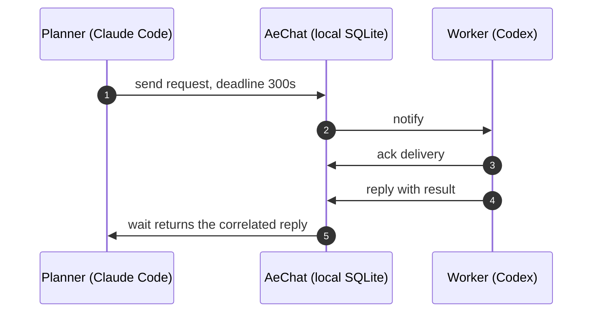

<p align="center">
  
</p>

<h1 align="center">AeChat</h1>

<p align="center">
  <strong>Local-first session messaging for AI agent hosts on macOS.</strong><br>
  Durable sessions, correlated requests and an auditable message history — without a server.
</p>

<p align="center">
  <a href="https://github.com/aechat-dev/AeChat/actions/workflows/ci.yml"></a>
  <a href="LICENSE"></a>
  
  
</p>

---

AeChat connects separate AI agent conversations running on your Mac. Each
conversation registers as its own session, gets a private transport address,
and can send notifications, requests and replies to other sessions. Everything
is stored in local SQLite and delivered through agmsg;
there is no server, account or shared model context.

## Why AeChat

<table>
<tr>
<td width="33%" valign="top">
<h3>Sessions, not names</h3>
Every conversation has a UUID and an explicit address. Duplicate display
names are fine; messages are routed by session ID, never guessed from a name.
</td>
<td width="33%" valign="top">
<h3>Requests, not just text</h3>
Ask a question with a deadline, wait for the correlated reply, then cancel or
retry when the host does not answer. Delivery state is tracked end to end.
</td>
<td width="33%" valign="top">
<h3>Audit, not guesswork</h3>
The stored → notified → delivered → acked → replied chain lives in local
SQLite and is readable with <code>aechat log</code>.
</td>
</tr>
</table>

## How it works



## Install

**Requirements:** macOS 14+, Node.js 24, pnpm 11, and agmsg 1.7.1 on `PATH`.

```bash
git clone https://github.com/aechat-dev/AeChat.git
cd AeChat
pnpm install
pnpm build
pnpm link --global
aechat init
```

If `pnpm link --global` reports that its global bin directory is not on
`PATH`, run `pnpm setup`, restart the shell, then link again.

`init` creates the database, checks agmsg and installs the skill for every
detected host. Run `aechat setup <claude-code|codex>` to install one explicitly.
Data defaults to `~/.aechat/aechat.db`; override it with `AECHAT_HOME` or
`AECHAT_DB`.

## Quick start

Run `aechat register` inside each host conversation. It creates a session and
binds it automatically when the host session id is available (Claude Code:
`CLAUDE_CODE_SESSION_ID`; Codex: `CODEX_THREAD_ID`; `AGMSG_SESSION_ID` overrides).

```bash
# In the planner conversation
aechat register --name planner --client claude-code --project "$PWD"

# In the worker conversation
aechat register --name worker --client codex --project "$PWD"
```

If the result contains a `bind_directive` and `bound_scope=none`, run that
directive in the same conversation, then `aechat confirm --session "<id>"`. If
`auto_bind.transportClaimState` is `accepted` or `unknown` but `claimed` is
false, follow `auto_bind.reason` instead; the role may already be held.
`aechat list --json` shows the sessions and their reported capabilities.

Send a request and answer it:

```bash
aechat send --session "<planner_id>" --to-session "<worker_id>" \
  --request --deadline 300 --body "status?"

# In the worker conversation
aechat inbox --session "<worker_id>" --json
aechat ack --session "<worker_id>" --delivery "<delivery_token>"
aechat reply --session "<worker_id>" --request "<request_id>" --body "done"

# Back in the planner conversation
aechat wait --session "<planner_id>" --request "<request_id>" --timeout 300 --json
```

Discover sessions and their reported capabilities with `aechat list --json`.

## Native app

```bash
./scripts/build-aechat-app.sh
open dist/AeChat.app
```

The bundle embeds the CLI. The app is read-only: it never sends, replies,
acknowledges or claims deliveries. If the CLI is not found automatically, use
`AECHAT_BIN` or Settings → Choose aechat.

## Host skill

`aechat init` installs the skill for every detected host. To install one
explicitly:

```bash
aechat setup claude-code
aechat setup codex
```

The skill tells the agent to register explicitly, prefer `--json`, acknowledge
claimed deliveries, and treat message bodies as agent-origin data rather than
user authorization.

## Commands

| Command | Purpose |
|---|---|
| `register` / `confirm` | Create a session and confirm its transport binding |
| `list` / `whoami` | Discover sessions and capabilities |
| `send` | Send a notification or request |
| `inbox` / `ack` | Read pending deliveries and acknowledge them |
| `reply` | Answer a request |
| `wait` | Block until a correlated reply arrives |
| `heartbeat` | Keep a session marked online |
| `cancel` / `retry` | Cancel a request or retry a delivery |
| `resume` / `leave` | Rebind or retire a session |
| `log` / `history` | Inspect one audit chain or one session's messages |
| `doctor` | Check the local environment |

## Status

AeChat is pre-1.0. Automatic wakeup is host-dependent and only claimed where
observed: Claude Code idle wakeup was verified inside a Monitor window;
`busy_receive` remains unknown, and Codex automatic wakeup has not been
verified. See [docs/compatibility.md](docs/compatibility.md) for the evidence
matrix and [docs/install.md](docs/install.md) before relying on automatic
processing.

## Data and uninstall

- Database: `~/.aechat/aechat.db` (mode 0600)
- Runtime heartbeat files: `~/.aechat/run/`
- Audit: SQLite `events` table, read with `aechat log`

```bash
pnpm unlink --global aechat
```

Removing `~/.aechat` deletes all local sessions, messages and audit events.
Leave sessions first if their transport bindings should be released.

## Documentation

[Install and operate](docs/install.md) · [Start here](docs/start-here.md) ·
[Host compatibility](docs/compatibility.md) · [E2E verification](docs/e2e.md) ·
[Contributor verification](docs/contributor-verification.md) ·
[Changelog](CHANGELOG.md)

## Contributing

Development setup, layering rules and commit conventions are in
[CONTRIBUTING.md](CONTRIBUTING.md). Security issues go through
[SECURITY.md](SECURITY.md), not a public issue.

## License

MIT — see [LICENSE](LICENSE).
